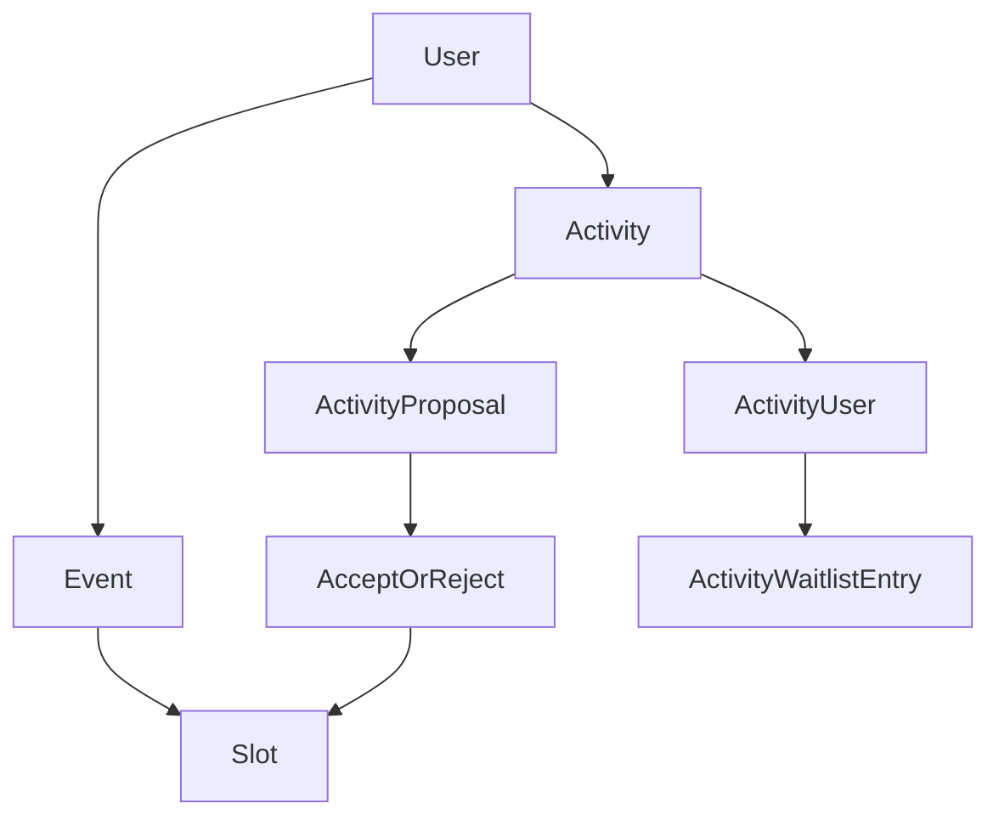

# Domain Mechanics

This document describes the app-level rules and flows behind events, activities, proposals, participation, groups, and play preferences.

## Entity Lifecycle

## Hosting Modes For Activities

Activities move through explicit hosting modes:

- `DRAFT`
- `SELF_HOSTED`
- `PROPOSED_TO_EVENT`
- `SCHEDULED_ON_EVENT`

Joinability rules depend on these modes. Participation is allowed only for joinable modes (self-hosted or scheduled on event), and cancelled activities are always blocked.

## Visibility Rules

- Public event pages are accessible by slug.
- Public activity pages require the activity to be attached to a public event (or self-hosted under the public browse constraints).
- Browse is unified under `/search`.

Key practical effect: not every existing activity row is publicly visible; visibility is constrained by hosting mode and event/slot state.

## Proposal Mechanics

## Submit

- A user proposes an activity to an event.
- Optional preferred free slots can be attached to the proposal.
- Event owner can be notified (except self-submissions where submitter is owner).

## Auto-Accept Path

When preferred slots are provided, the system can auto-accept only if there is a free non-approval slot that fits:

- activity type compatibility,
- slot duration fit,
- slot capacity fit.

If no fitting slot exists, proposal remains pending.

## Manual Accept/Reject

- Accept assigns the activity to a chosen free slot (or auto-selects a fitting free slot when no slot ID is provided).
- Reject clears accepted slot and marks proposal rejected.
- Decision triggers status updates and notifications to the proposal creator.

## Organizer Schedule Without Proposal

Event organizers (and co-organizers) can create a scheduled activity and its slot in one modal from the event page. That path does not go through `ActivityProposal`; the activity is created already in `SCHEDULED_ON_EVENT`.

## Participation And Waitlist Mechanics

## Join

Join is blocked if:

- the activity is cancelled,
- hosting mode is not joinable,
- user already participates,
- user is already on waitlist,
- activity requires approval (user should join waitlist instead),
- participant limit is reached,
- the activity host has banned the user (also blocks waitlist, invites, and host waitlist approval).

## Waitlist

Users can join waitlist when:

- activity requires approval, or
- activity is full.

Hosts can approve waitlist entries (for approval-required activities), subject to:

- ownership/authorization checks,
- capacity checks,
- signup validation checks.

When a participant leaves, waitlist auto-promotion happens only when approval is not required; approval-required activities leave the spot open for host selection.

## Host Roster Controls

Hosts can:

- mark participants absent/unmark absent,
- move participants to waitlist,
- remove participants,
- ban a user from all of their activities (from the user contact popup, if they have hosted at least once).

Banning removes the user from the host’s upcoming roster and waitlist rows and blocks future joins; past activities are left unchanged. Unban only clears the ban (no automatic re-join).

Host self-removal/move protections are enforced where applicable.

## Reputation Warning

A `!` indicator appears on a user’s badge when they have been banned by at least two distinct hosts, or marked absent at least three times. Ban and absence counts are shown on the user contact popup statistics tab.

## Authorization Model

- Admin users can modify any entity.
- Non-admin users can modify entities only when `created_by` matches their user ID.
- Proposal and participation decisions use these ownership checks for protected actions.

## Groups And Shared Availability

- **Group** is a shared availability party (not Organization). The creator is owner (`created_by`) and is always a member. New groups default to **private** visibility.
- **Private** groups are visible only to members (and admins). **Public** groups can be discovered and joined by any signed-in user via open join; switching back to private keeps existing members but stops new discovery/joins.
- Only the owner may invite (via `UserRequestType::GroupInvite`), remove members, rename, change visibility, or delete the group. Other members may leave.
- Non-members who can open a public group page see summary metadata only (name, description, tags, area, member count)—not the shared availability calendar or member roster until they join.
- **Availability is global per user:** weekday defaults and date exceptions live on the user profile; every group aggregates members’ resolved status for each calendar day.
- Resolve order for a date: date exception → weekday default → uncertain when no defaults are stored.
- Group calendar UI shows per-day available counts, optional minimum-available / all-members filters, and day detail lists (available / unavailable / uncertain).
- Owners set optional **location** (play area) and **tags**. The **Discover** tab lists users whose play preferences overlap those tags/area so members can invite them.
- From a calendar day, a member can create an activity prefilled with that date. Members marked **available** that day (except the host, and except users the host has banned) can be enrolled automatically, up to activity capacity.

## Play Preferences And Browse Matching

- Each user may set a **play area** (map bbox/radius) and **interest tags** on the profile Play preferences tab.
- Those preferences appear on the user contact preview when the viewer is allowed to open it.
- Browse `/search` can apply the signed-in user’s preferences in one step (tags + play-area bbox). Find groups can filter public groups by the same play area and by tags.

## Time, Audit, And Deletion Conventions

- Datetimes are stored in UTC.
- Profile timezone controls displayed time in UI.
- Core entities include audit columns (`created_by`, `updated_by`) populated from authenticated context.
- Soft deletes are used on key models.

Additional deletion guardrails:

- Activities scheduled on events or with roster pressure cannot be hard deleted.
- Events with scheduled activities or signup pressure are expected to be cancelled instead of hard-deleted.
